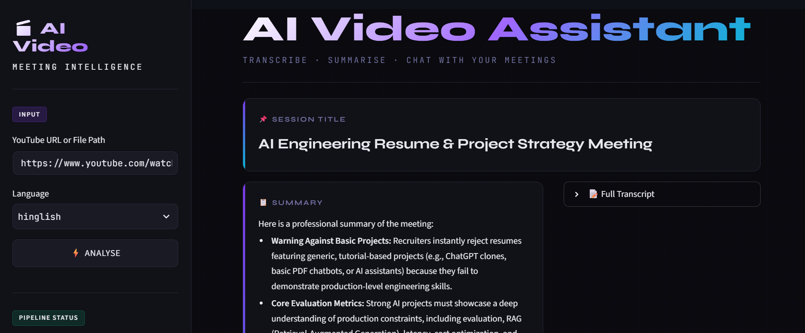
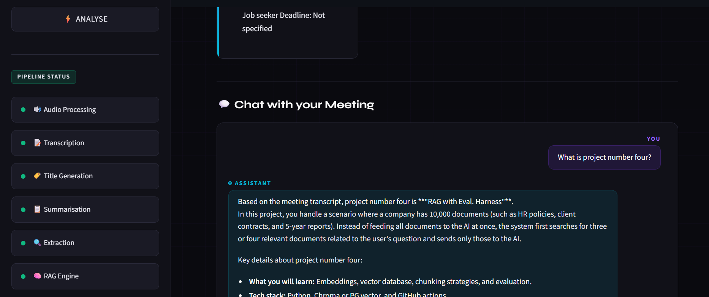
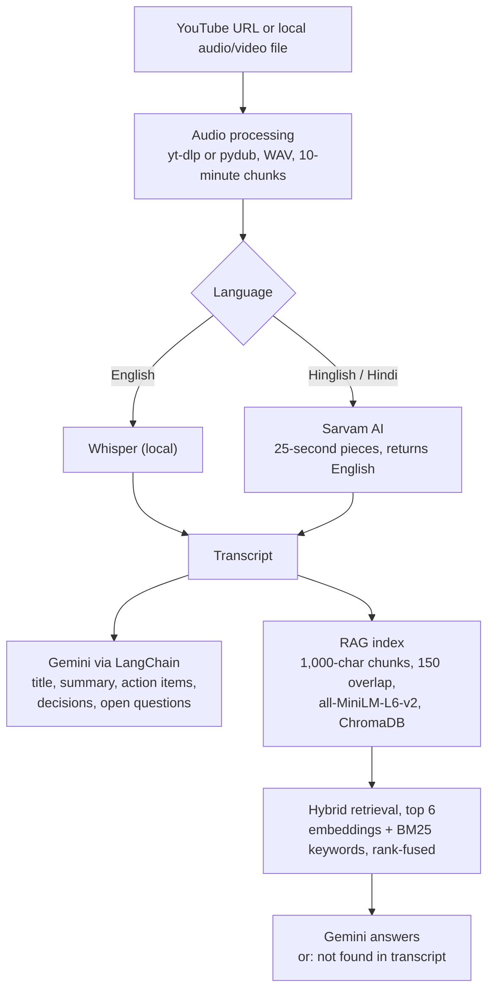

# 🎬 Gen-AI Video Analyzer

**Transcribe · Summarise · Chat with your meetings and videos**


<p align="center">
  
  
</p>

Gen-AI Video Analyzer turns a YouTube video or a local audio/video file into structured meeting notes. It transcribes the audio, writes a title and summary, extracts action items, key decisions and open questions, and then lets you **chat with the content** through a Retrieval-Augmented Generation (RAG) pipeline.

It supports **English** audio (local OpenAI Whisper) and **Hinglish / Hindi** audio (Sarvam AI speech-to-text-translate, which returns English text).

---

## ✨ Features

- **Flexible input**: a YouTube URL or a path to a local file (`.mp4`, `.mp3`, `.wav`, `.m4a`, ...)
- **Two transcription engines**
  - `english` → OpenAI Whisper, running locally (model size set with `WHISPER_MODEL`, default `small`)
  - `hinglish` → Sarvam AI (`saaras:v2.5`), which transcribes and translates to English in one step
- **Title and summary**: a title of at most 8 words, and a bullet-point summary. Short transcripts are summarised in one call; long ones use map-reduce (summarise parts, then merge)
- **Structured extraction**: action items (with owner and deadline), key decisions and open questions, parsed from a single LLM call
- **RAG chat**: ask questions about the video; the prompt restricts answers to the retrieved transcript and tells the model to say so when the answer is not there
- **Two interfaces**: a Streamlit web app and an interactive command-line mode

---

## 🧠 How it works



### Design notes

| Concern | What the code does |
|---|---|
| Sarvam's 30-second API limit | Each 10-minute chunk is cut into 25-second pieces, transcribed separately and joined (`SARVAM_PIECE_SECONDS`) |
| Long transcripts | Summary: one call up to 20,000 characters, otherwise 8,000-character parts (200 overlap) are summarised and merged. Extraction: one combined call up to 20,000 characters, otherwise split into parts and merged |
| Fewer LLM calls | Action items, decisions and questions come from one prompt; any section missing from the answer is extracted separately |
| Rate limits | `core/llm.py` retries Gemini up to 6 times with exponential backoff and jitter (10 s to 60 s) |
| One video at a time | Every analysis **replaces** the stored transcript in `vector_db/`, so chat answers never mix videos |

---

## 🛠️ Tech stack

| Layer | Tools |
|---|---|
| Audio acquisition | `yt-dlp`, `pydub`, FFmpeg |
| Speech-to-text | OpenAI Whisper (local), Sarvam AI API |
| LLM | Google Gemini (default `gemini-3.5-flash-lite`) |
| Orchestration | LangChain (LCEL) |
| Embeddings | `sentence-transformers/all-MiniLM-L6-v2` |
| Vector store | ChromaDB |
| UI | Streamlit |
| Tests / CI | pytest, GitHub Actions |

---

## 📁 Project structure

```
gen-ai-video-analyzer/
├── app.py                  # Streamlit web interface
├── main.py                 # CLI entry point + run_pipeline()
├── test.py                 # Manual end-to-end script (needs API keys)
├── Requirements.txt        # Runtime dependencies
├── requirements-dev.txt    # What the unit tests need
├── core/
│   ├── llm.py              # Gemini client with retry
│   ├── transcriber.py      # Whisper + Sarvam AI transcription
│   ├── summarizer.py       # Title + map-reduce summary
│   ├── extractor.py        # Action items, decisions, open questions
│   ├── vector_store.py     # ChromaDB + MiniLM embeddings
│   ├── hybrid.py           # BM25 + embedding hybrid retrieval
│   └── rag_engine.py       # RAG chain for Q&A
├── utils/
│   └── audio_processor.py  # YouTube download, WAV conversion, chunking
├── eval/                   # Retrieval and answer evaluation (qa_set.json, run_eval.py)
├── docs/                   # README screenshots
├── tests/                  # Unit tests (no API key, audio or model needed)
└── .github/workflows/ci.yml
```

---

## 🚀 Getting started

### 1. Prerequisites

- **Python 3.10+**
- **FFmpeg** on your `PATH` ([download](https://ffmpeg.org/download.html)). If it is installed elsewhere, set `FFMPEG_PATH` in `.env`
- A **Google Gemini API key** ([aistudio.google.com](https://aistudio.google.com/))
- A **Sarvam AI API key**, only for Hinglish ([sarvam.ai](https://www.sarvam.ai/))

### 2. Install

```bash
git clone https://github.com/shushant11/gen-ai-video-analyzer.git
cd gen-ai-video-analyzer

python -m venv venv
source venv/bin/activate        # Windows: venv\Scripts\activate

pip install -r Requirements.txt
```

### 3. Configure

Copy `.env.example` to `.env` and fill in your keys:

```env
GOOGLE_API_KEY=your_gemini_key
SARVAM_API_KEY=your_sarvam_key        # only for Hinglish

# Optional
GEMINI_MODEL=gemini-3.5-flash-lite
WHISPER_MODEL=small                   # tiny | base | small | medium | large
SARVAM_STT_MODEL=saaras:v2.5
# FFMPEG_PATH=C:\tools\ffmpeg\bin\ffmpeg.exe
```

---

## 💻 Usage

### Streamlit app

```bash
streamlit run app.py
```

1. Paste a YouTube URL or a local file path in the sidebar
2. Choose `english` or `hinglish`
3. Click **⚡ Analyse**
4. Read the title, summary, transcript, action items, decisions and open questions
5. Ask questions in **💬 Chat with your Meeting**

### Command line

```bash
python main.py
```

### Manual end-to-end script

Edit `source` and `language` in `test.py`, then run `python test.py`.

---

## ✅ Tests

```bash
pip install -r requirements-dev.txt
pytest -q
```

The unit tests replace the LLM with a fake, so they need no API key, audio file or model download. They cover the extraction parser (heading styles, missing-section fallback, long-transcript split and merge) and the summariser's single-call versus map-reduce behaviour. CI runs them on every push.

Not covered by the unit tests: transcription, audio conversion and live RAG answers. Retrieval and answer quality are measured separately in [Evaluation](#-evaluation); word error rate is not measured yet.

---

## 📏 Evaluation

`eval/` holds a small, repeatable check of the RAG part, so settings are chosen from measurements.

- **Corpus:** one 12,479-character transcript (`eval/transcript_ai_projects.txt`).
- **Question set:** `eval/qa_set.json` has 43 answerable questions, each tied to the exact transcript sentence(s) that answer it, and 6 questions the transcript does not answer.
- **Retrieval metric:** a question is a *hit* when the retrieved chunks cover at least half of one evidence sentence, and *full* when every evidence sentence is covered. Chunk positions come from `start_index`, so the check does not depend on wording.
- **Answer metric (`--answers`):** answerable questions pass if the reply is not the not-found message and contains the expected keywords; unanswerable ones pass if the reply is the not-found message.

```bash
python -m eval.run_eval                       # retrieval, embeddings vs hybrid: free, no API calls
python -m eval.run_eval --answers             # also asks Gemini, embeddings-only retrieval
python -m eval.run_eval --answers --hybrid    # same, with the hybrid retriever the app now uses
```

### Results

Measured on a 12,479-character transcript with 43 answerable and 6 unanswerable questions. Retrieval hit rate, embeddings only → hybrid (embeddings + BM25 keyword search, rank-fused):

| Chunk size | Chunks | k=2 | k=4 | k=6 | k=8 |
|---|---|---|---|---|---|
| 300 | 83 | 63 → 70% | 72 → 81% | 79 → 91% | 81 → 93% |
| 500 | 36 | 65 → 79% | 72 → 91% | 79 → 95% | 86 → 98% |
| **1000** | 15 | 65 → 88% | 86 → 98% | **91 → 100%** | 95 → 100% |
| 1500 | 10 | 58 → 84% | 77 → 93% | 86 → 100% | 95 → 100% |

Picking k chunks at random would score k / chunks (40% for chunk 1000, k 6; 80% for chunk 1500, k 8), so read large-k rows on this short transcript with care.

| End-to-end (Gemini, chunk 1000, k 6) | Embeddings only | Hybrid (current app) |
|---|---|---|
| Answerable questions passing the keyword check | 36 / 43 (84%) | 41 / 43 (95%) |
| Unanswerable questions correctly refused | 6 / 6 | 6 / 6 |

- **Why hybrid:** embeddings only wrongly refused "What is project number four / five?" and gave two other wrong answers, probably because embedding search matches a bare spoken number poorly. Adding keyword search fixed all four.
- **Chunk size:** 1000 characters or more beats 300 and 500, because small chunks split the sentences that answer a question.
- **Remaining 2 automatic failures:** both answers are correct on reading and only miss one of my keywords (a strict scorer).

Limitations: one 12,479-character transcript, so the numbers describe this document and are not a general accuracy claim. The hybrid retriever was designed after seeing the embeddings-only failures on these same 43 questions, so its gain is not measured on unseen questions. Keyword matching for answers is a rough check, and one question is worth 2.3 points.

---

## ⚠️ Limitations

- Transcripts are sent to the Gemini API (and Hinglish audio to Sarvam), so don't use confidential recordings
- One video is indexed at a time; a new analysis replaces the previous one
- Temporary WAV chunks are not deleted after processing
- Output quality depends on audio quality and the chosen Whisper model size

---

## 🗺️ Roadmap

- [x] Measure retrieval hit rate and answer accuracy on a labelled question set (see Evaluation)
- [ ] Report transcription speed and word error rate for Whisper versus Sarvam
- [ ] Export results to PDF / TXT
- [ ] Speaker diarization
- [ ] Clean up temporary audio files

---

## 📄 License

No license has been added yet.

---

## 🙏 Acknowledgements

[OpenAI Whisper](https://github.com/openai/whisper) · [Sarvam AI](https://www.sarvam.ai/) · [Google Gemini](https://ai.google.dev/) · [LangChain](https://www.langchain.com/) · [ChromaDB](https://www.trychroma.com/) · [Streamlit](https://streamlit.io/)